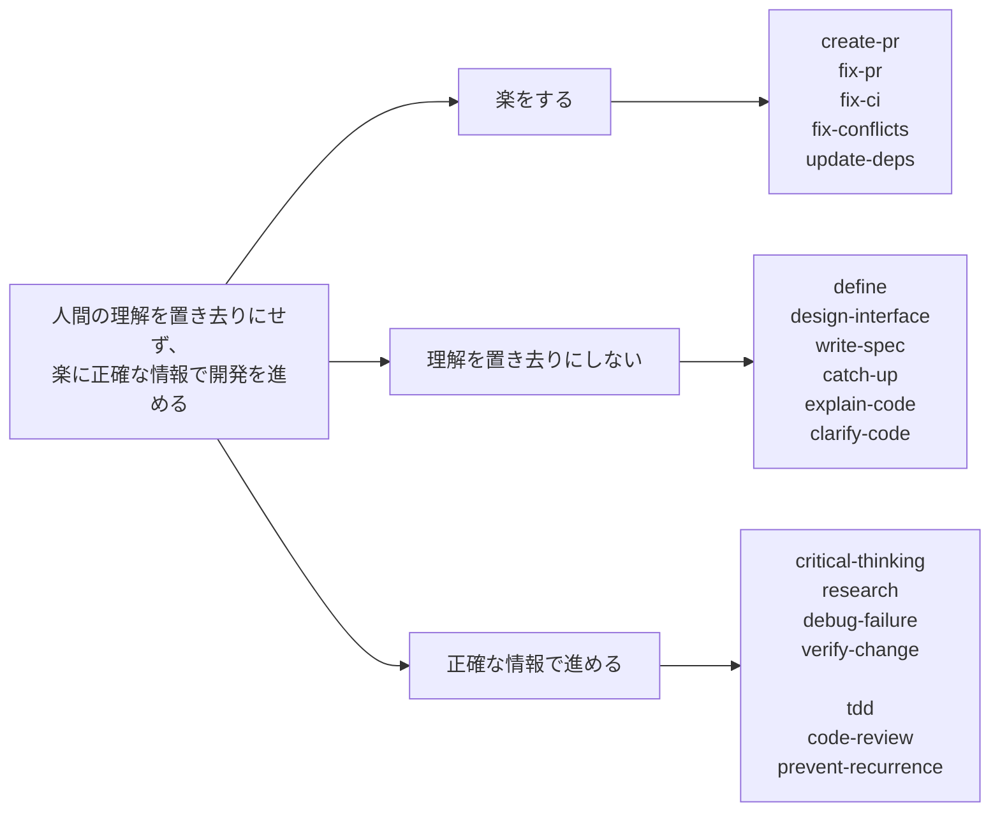

# everything-codex

> **人間の理解を置き去りにせず、楽に正確な情報で開発を進める。**

この思想に基づいて、Codex と Claude Code の skill 群と、Codex の設定を管理しています。
エージェントに作業を任せても、人が状況を理解し、事実に基づいて判断できる状態を保ちます。



## 3 つの柱

### 楽をする

好きなタイミングで呼ぶと、定型作業をエージェントが考えて実施します。

| skill | 用途 | 呼び出し |
| --- | --- | --- |
| `create-pr` | 変更を commit・push し、Draft PR を作成または更新する。 | 手動 |
| `fix-pr` | PR のレビュー指摘を検証・修正し、返信案を作る。 | 手動 |
| `fix-ci` | PR で失敗した CI を調査し、修正して commit・push する。 | 手動 |
| `fix-conflicts` | PR の merge conflict を解消し、検証して commit・push する。 | 手動 |
| `update-deps` | 指定した依存関係を最新の安定版へ更新し、検証する。 | 手動 |

### 理解を置き去りにしない

人が理解し、自分の言葉で説明できる状態を保ちます。

| skill | 用途 | 呼び出し |
| --- | --- | --- |
| `define` | 実装前に困りごとを確かめ、本当に欲しいものを短い仕様にまとめる。 | 手動 |
| `design-interface` | 使い方・型・名前・モジュールの分け方を合意してから実装する。 | 手動 |
| `write-spec` | 全体像から 1 section ずつ合意し、理解して説明できる仕様書を作成・更新する。 | 手動 |
| `catch-up` | 何が変わり、何を判断すべきかを、判断材料つきで腹落ちする形で伝える。 | 自動 |
| `explain-code` | コードがどう動き、なぜその形なのかを結論から順に説明する。 | 手動 |
| `clarify-code` | 対象差分の処理と関連コメントを精査し、振る舞いを保って追いやすくする。 | 手動 |

### 正確な情報で進める

推測で進めず、確かめた事実で判断します。

| skill | 用途 | 呼び出し |
| --- | --- | --- |
| `critical-thinking` | 前提を批判的に検討し、相手の言うことを正しく理解してから返信や方針を出す。 | 自動 |
| `research` | 外部情報の調査と事実確認を行い、結論を支える根拠と適用条件を確かめる。 | 自動 |
| `debug-failure` | 問題を見つけたら、原因を特定してから根本原因を直す。 | 自動 |
| `verify-change` | 完了を報告する前に、変更を実際に動かして確かめる。 | 自動 |
| `tdd` | 振る舞いごとに RED → GREEN → REFACTOR を進める。 | 自動 |
| `code-review` | PR やローカル変更を複数の観点でレビューする。 | 手動 |
| `prevent-recurrence` | 繰り返す指摘を、構造・型・lint・テストで起こせなくする。 | 手動 |

## 使い方

- 手動の skill は、Codex では `$skill-name`、Claude Code では `/skill-name` で呼び出す。
- 自動の skill は、該当する場面でエージェントが使う。手動でも呼び出せる。
- 各 skill は単体で動き、他の skill を呼び出さない。
- 自動で使われる条件や引数は、各 `SKILL.md` に記載している。

## 開発者向け情報

### 構成

| パス | 内容 |
| --- | --- |
| `skills/<name>/SKILL.md` | skill の手順 |
| `skills/<name>/agents/openai.yaml` | skill の表示情報と呼び出し設定 |
| `skills/<name>/references/` | skill の補足資料 |
| `.codex/config.toml`、`.codex/agents/` | Codex とエージェントの設定 |
| `AGENTS.md`、`.codex/AGENTS.md` | 作業時の指示 |
| `.github/workflows/` | lint と GitHub Actions の参照先固定の検証・更新 |
| `.github/PULL_REQUEST_TEMPLATE.md` | PR の記載項目と確認事項 |

### Codex のモデル設定

- 通常の作業と、調査・実装・レビュー用のエージェント: `gpt-6.1-sol`
- 文書調査用のエージェント: `gpt-6-luna`

### セットアップと検証

Node.js 24 と、`package.json` で指定した pnpm を mise で使用します。

```bash
mise install
mise exec -- pnpm install --frozen-lockfile
mise exec -- pnpm lint:md     # Markdown の記法
mise exec -- pnpm lint:spell  # スペルと登録語
mise exec -- pnpm lint:text   # 日本語の文章
```

## ライセンス

MIT License です。詳細は `LICENSE` を参照してください。
